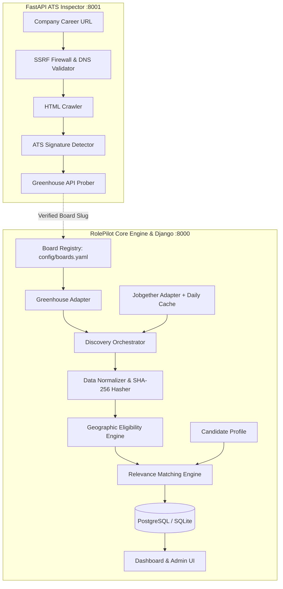

# RolePilot 🚀

> **Automated Job Discovery, ATS Career Page Inspection & Multi-Stack Candidate Matching Platform**

RolePilot is a personal job automation platform built to eliminate manual job hunting, tedious board browsing, and copy-pasting URLs. It pairs a **Django-powered matching and dashboard application** with a **FastAPI career page inspection microservice** to discover, analyze, and evaluate job opportunities against candidate profiles.

---

## 🌟 Key Features

- **Automated Multi-Source Discovery**:
  - **Greenhouse Public Board API**: Ingests complete company postings (titles, clean descriptions, raw HTML, departments, offices) without premature source filtering.
  - **Jobgether Aggregator API**: Fetches remote/hybrid listings with daily disk caching (strictly capped at 100 jobs / 4 API calls per 24 hours).
- **FastAPI ATS Career Page Inspector (`rolepilot-inspector`)**:
  - Bounded, headless crawler that inspects arbitrary career URLs to detect underlying ATS platforms (Greenhouse, Lever, Ashby, Workday).
  - Verifies public API availability and extracts valid board slugs.
  - **Hardened SSRF Defenses**: DNS pre-resolution, CIDR blacklisting (private, loopback, cloud metadata IPs), and bounded 2MB streaming.
- **Conservative Geographic Eligibility Engine**:
  - Distinguishes **work mode** (remote, hybrid, on-site) from **geographic legal jurisdiction** (e.g., APAC, India, worldwide).
  - Prevents false-positive matches: ambiguous or unspecified payroll bounds are marked `NEEDS_VERIFICATION`.
- **Multi-Stack Relevance Matcher**:
  - Weighted scoring across target roles, programming languages (Python, Go, Java, TypeScript, etc.), and technical skills.
  - Hard negative exclusions (e.g., WordPress, PHP, sales roles).
  - Spoken human languages (English, German, etc.) are separated from programming languages and never disqualify candidates.
- **Fingerprinting & Idempotency**:
  - Canonical postings are content-hashed using SHA-256 to track updates and eliminate duplicates.
- **Modern Web Dashboard**:
  - Candidate profile preferences editor (location, target titles, tech stack).
  - Match scoring and recommendation badges (`MATCH`, `REVIEW`, `EXCLUDE`).
  - One-click discovery execution and real-time status monitoring.
  - Historical run telemetry and error tracking.

---

## 🏗️ Architecture Overview



---

## 📁 Project Structure

```text
├── config/
│   └── boards.yaml            # Configured company Greenhouse board slugs
├── inspector/                 # FastAPI ATS Inspector microservice
│   ├── crawler.py             # Bounded HTTP streaming fetcher
│   ├── detector.py            # Multi-ATS regex signature detection
│   ├── main.py                # FastAPI entrypoint
│   ├── probers/               # Provider-specific API verification
│   ├── router.py              # REST API (/api/v1/inspect)
│   ├── schemas.py             # Pydantic request/response models
│   └── ssrf.py                # DNS pre-resolution & CIDR firewall
├── jobs/                      # Django application
│   ├── management/commands/   # CLI commands (discover_jobs, inspect_career_page)
│   ├── models.py              # CanonicalJob, CandidateProfile, MatchResult models
│   ├── services.py            # Discovery & inspection service bridges
│   ├── views.py               # Web dashboard and discovery endpoints
│   └── urls.py                # Routing
├── rolepilot/                 # Django project settings & WSGI configuration
├── src/                       # Core engine & standalone library
│   ├── adapters/              # Provider adapters (BaseJobProvider, Greenhouse, Jobgether)
│   ├── analyzer/              # Text cleaner, skills extractor, work mode detector
│   ├── matcher/               # Geo eligibility & multi-stack relevance matchers
│   ├── orchestrator.py        # Discovery orchestrator with deduplication & caps
│   ├── runner.py              # Standalone CLI discovery runner
│   └── schemas/               # Canonical Pydantic schemas (job, candidate)
├── templates/                 # Server-rendered HTML dashboard templates
├── tests/                     # Test suite (pytest)
├── docker-compose.yml         # Multi-container orchestration (DB, Web, Inspector)
├── Dockerfile                 # Web application Dockerfile
├── Dockerfile.inspector       # Inspector microservice Dockerfile
├── requirements.txt           # Python dependencies
└── pyproject.toml             # Project metadata & test configuration
```

---

## ⚡ Quickstart with Docker Compose

The easiest way to run the full stack (PostgreSQL, Django Web Dashboard, and FastAPI Inspector) is with Docker Compose:

```bash
docker compose up --build
```

### Services Started:
- **RolePilot Web Dashboard**: [http://localhost:8000](http://localhost:8000)
- **Career Page Inspector API Docs**: [http://localhost:8001/docs](http://localhost:8001/docs)
- **PostgreSQL Database**: Port `5432` with automated schema migrations and persistent volumes.

---

## 💻 Local Development Setup

### 1. Prerequisites
- Python 3.11+
- Virtual environment tool (`venv`)
- (Optional) Docker for local PostgreSQL, or default to SQLite.

### 2. Environment Setup

```bash
# Clone the repository
git clone https://github.com/Assassin23/RolePilot.git
cd RolePilot

# Create and activate virtual environment
python -m venv .venv
# On Windows:
.venv\Scripts\activate
# On Linux/macOS:
source .venv/bin/activate

# Install dependencies
pip install -r requirements.txt
```

### 3. Database Migrations

```bash
python manage.py migrate
```

### 4. Create an Admin User (Optional)

```bash
python manage.py init_admin
# Or standard Django createsuperuser:
python manage.py createsuperuser
```

### 5. Running Services Locally

#### Run the Career Page Inspector (Terminal 1):
```bash
uvicorn inspector.main:app --host 0.0.0.0 --port 8001 --reload
```

#### Run the RolePilot Web Server (Terminal 2):
```bash
python manage.py runserver 8000
```

---

## 🛠️ CLI & Management Commands

### Run Job Discovery via Django CLI
Executes the discovery orchestrator against configured boards and Jobgether, evaluates matches against all active candidate profiles, and persists results to the database:
```bash
python manage.py discover_jobs
```

### Inspect a Company Career Page
Scans a target URL with SSRF protection, identifies the ATS, and verifies if the public board is active:
```bash
python manage.py inspect_career_page https://www.cloudflare.com/careers/jobs/
```

### Standalone Orchestrator Demo Runner
Runs the core pipeline without Django, outputting formatted terminal summaries:
```bash
# Simulation mode (uses local test fixtures)
python -m src.runner --simulate

# Live mode (queries live Greenhouse boards)
python -m src.runner --live
```

---

## 🧪 Testing

The test suite covers provider adapters, HTML cleaning, SSRF validation, geographic eligibility heuristics, and relevance matching:

```bash
pytest
```

To run with verbose output:
```bash
pytest -v
```

---

## ⚙️ Configuration

### Company Boards (`config/boards.yaml`)
Add or toggle company Greenhouse boards:

```yaml
boards:
  - name: "GitLab"
    token: "gitlab"
    enabled: true
  - name: "Cloudflare"
    token: "cloudflare"
    enabled: true
  - name: "Canonical"
    token: "canonical"
    enabled: true
```

### Environment Variables

| Variable | Default | Description |
| :--- | :--- | :--- |
| `DJANGO_DEBUG` | `True` | Enables Django debug mode |
| `DJANGO_SECRET_KEY` | *(dev key)* | Django security secret key |
| `POSTGRES_HOST` | `localhost` | PostgreSQL host (`db` in Docker) |
| `POSTGRES_PORT` | `5432` | PostgreSQL port |
| `POSTGRES_DB` | `rolepilot` | Database name |
| `POSTGRES_USER` | `rolepilot` | Database username |
| `POSTGRES_PASSWORD` | `rolepilot_secret` | Database password |
| `INSPECTOR_SERVICE_URL` | `http://localhost:8001` | URL for the companion Inspector service |

---

## 📄 License

This project is licensed under the MIT License.
